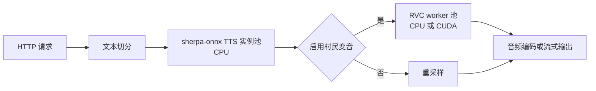

<h1 align="center">Villager TTS</h1>

<p align="center"><strong>一个可自托管的《我的世界》村民音色 TTS 服务</strong></p>

<p align="center">
  <a href="https://github.com/tropical-algae/villager-tts/actions/workflows/quality.yml"></a>
  
  
</p>

Villager TTS 是一个提供《我的世界》村民风格语音生成的服务，适合在聊天机器人、游戏或自动化工作流中自托管使用。

服务提供 OpenAI TTS 兼容接口、完整 WAV 文件接口和低延迟 L16 流式接口。

发布镜像
包含经过校验的模型文件，容器启动时只加载模型，不会联网下载依赖或权重。

## 功能特性

- **OpenAI 接口兼容**：通过 `POST /v1/audio/speech` 接入现有 OpenAI TTS 客户端，支持 MP3、Opus、AAC、FLAC、WAV 和 PCM 输出

- **双源声音**：提供中文男声和中英双语女声；原生接口默认使用女声

- **可选村民变音**：原生接口可关闭 RVC，直接获取重采样后的 TTS 音频，方便试听和音质排查

- **并发推理**：TTS 使用预加载实例池，RVC 使用独立子进程池，可按机器资源扩展模型实例数量

- **CPU 与 CUDA 镜像**：CPU 镜像运行完整流水线；CUDA 12.1 镜像将 RVC 放到 GPU，TTS 继续使用 CPU


## 快速开始

推荐直接运行已经包含模型的 Docker 镜像。`latest` 始终指向最新的 CPU 版本。

<details open>

<summary><strong>🐳 Docker 部署</strong></summary>

<br>

**CPU 版本**

```bash
docker run -d \
  --name villager-tts \
  --restart unless-stopped \
  -p 8000:8000 \
  tropicalalgae/villager-tts:latest
```

服务启动后，可以查看模型是否已经加载完成：

```bash
curl http://127.0.0.1:8000/health/ready
```

`/health/ready` 返回 `200` 和 `status: ready` 后即可开始合成。模型加载失败时，进程仍会
保留 `/health/live` 和诊断日志，但 readiness 会返回 `503`。

生产环境建议启用 API Key：

```bash
docker run -d \
  --name villager-tts \
  --restart unless-stopped \
  -p 8000:8000 \
  -e VILLAGER_TTS_API_KEY="change-this-key" \
  tropicalalgae/villager-tts:latest
```

客户端随后使用 `Authorization: Bearer <key>` 或 `X-API-Key: <key>` 进行鉴权。

**镜像标签**

| 标签 | 推理设备 | 说明 |
| --- | --- | --- |
| `latest` | CPU | 最新发布的 CPU 镜像 |
| `<version>-cpu` | CPU | 固定版本的 CPU 镜像 |
| `<version>-cuda121` | CPU + CUDA 12.1 | TTS 使用 CPU，RVC 使用 NVIDIA GPU |

</details>

<details>

<summary><strong>⚡ CUDA 部署</strong></summary>

<br>

```bash
VERSION=x.y.z

docker run -d \
  --name villager-tts \
  --restart unless-stopped \
  --gpus all \
  -p 8000:8000 \
  "tropicalalgae/villager-tts:${VERSION}-cuda121"
```

CUDA 只用于 RVC。两个镜像中的 sherpa-onnx TTS 都固定使用 CPU，避免 TTS 与 RVC
争用显存。

</details>

<details>

<summary><strong>📦 Docker Compose 源码构建</strong></summary>

<br>

仓库中的 [compose.yaml](compose.yaml) 会从源码构建镜像。构建过程需要一个能够读取
私有模型仓库 `tropicalalgae/tts-rvc-models` 的 Hugging Face read-only token：

```bash
export HF_TOKEN="<read-only-token>"

docker compose --profile cpu up --build -d
```

CUDA 版本改用：

```bash
docker compose --profile cuda up --build -d
```

`HF_TOKEN` 通过 BuildKit secret 提供给模型下载步骤，不会写入镜像层。任一模型缺失、
文件大小不符或 SHA-256 校验失败都会终止构建。

</details>

<details>

<summary><strong>🛠️ 本地开发运行</strong></summary>

<br>

本地运行需要 Python 3.11、[uv](https://docs.astral.sh/uv/) 和 FFmpeg。完整模型与两套
Python 环境建议预留约 5 GiB 空间。

```bash
uv sync --frozen
uv sync --project workers/rvc --frozen --extra cpu

HF_TOKEN="<read-only-token>" uv run villager-tts-download-models

cp .env.example .env
uv run poe serve
```

若本地使用 CUDA 12.1，将 worker 安装命令改为：

```bash
uv sync --project workers/rvc --frozen --extra cuda121
```

项目包含两个独立环境：根目录 `.venv` 运行 FastAPI、sherpa-onnx 和音频编排；
`workers/rvc/.venv` 运行 RVC、PyTorch 和 Fairseq。启动服务不会执行 `uv sync`，也不会
在运行时临时下载 PyTorch。

</details>

## API 使用

### OpenAI 兼容接口

OpenAI 兼容接口位于 `POST /v1/audio/speech`：

```bash
curl --fail-with-body http://127.0.0.1:8000/v1/audio/speech \
  --header 'Content-Type: application/json' \
  --data '{
    "model": "villager-tts",
    "input": "你好，我是村民。",
    "voice": "female",
    "response_format": "mp3",
    "speed": 1.0
  }' \
  --output villager.mp3
```

启用 API Key 后，增加以下请求头：

```text
Authorization: Bearer <key>
```

| 字段 | 是否必填 | 默认值 | 说明 |
| --- | --- | --- | --- |
| `model` | 是 | — | 兼容 OpenAI 协议的模型标识；当前固定使用已部署模型 |
| `input` | 是 | — | 要合成的文本，最大长度由服务配置决定 |
| `voice` | 是 | — | `female` 为中英双语女声，`male` 为中文男声 |
| `response_format` | 否 | `mp3` | `mp3`、`opus`、`aac`、`flac`、`wav` 或 `pcm` |
| `speed` | 否 | `1.0` | 语速倍率，范围 `0.25`–`4.0` |
| `instructions` | 否 | — | 为协议兼容而保留；当前固定 TTS 后端不会应用该字段 |
| `stream_format` | 否 | `audio` | 当前只支持 `audio`，暂不支持 SSE |

该接口始终启用村民变音，并在完整音频编码完成后返回响应。`model` 字段用于兼容客户端
和记录请求，当前不会根据其值切换模型。

### 原生接口

原生接口允许选择是否启用村民变音：

| 接口 | 输出 | 用途 |
| --- | --- | --- |
| `POST /v1/audio/speech/file` | 48 kHz、mono、PCM16 WAV | 获取完整音频文件 |
| `POST /v1/audio/speech/stream` | 48 kHz、mono、big-endian PCM16 L16 | 尽快获取首个短语的音频 |

两个接口使用相同的请求字段：

```json
{
  "input": "你好，我是村民。",
  "speed": 1.0,
  "gender": "female",
  "enable_villager": true
}
```

`gender` 默认为 `female`，可设置为 `male`。`enable_villager` 默认为 `true`；设为
`false` 时返回原始 TTS 音频。

流式输出可以保存后使用 FFmpeg 或 ffplay 播放：

```bash
curl --no-buffer --fail-with-body http://127.0.0.1:8000/v1/audio/speech/stream \
  --header 'Content-Type: application/json' \
  --data '{"input":"你好，我是村民。"}' \
  --output villager.l16

ffplay -f s16be -ar 48000 -ac 1 villager.l16
```

### 服务端点

| 路径 | 说明 |
| --- | --- |
| `/docs` | FastAPI 在线交互文档 |
| `/health/live` | 检查 HTTP 进程是否可以响应 |
| `/health/ready` | 检查模型是否存在、是否完成加载和预热 |
| `/metrics` | Prometheus 指标 |

每个 HTTP 响应都包含 `X-Request-ID`，便于将客户端错误与服务日志对应起来。

## 配置说明

服务从 `.env` 和环境变量读取配置，所有环境变量都使用 `VILLAGER_TTS_` 前缀。修改后
需要重启服务。以下是常用选项：

| 配置项 | 说明 | 默认值 |
| --- | --- | --- |
| `VILLAGER_TTS_PORT` | HTTP 服务监听端口 | `8000` |
| `VILLAGER_TTS_LOG_LEVEL` | 结构化日志级别 | `INFO` |
| `VILLAGER_TTS_API_KEY` | Bearer token 或 `X-API-Key` 共享密钥；留空时关闭鉴权 | 未设置 |
| `VILLAGER_TTS_RVC_DEVICE` | RVC 推理设备：`auto`、`cpu` 或 `cuda` | `auto` |
| `VILLAGER_TTS_MAX_TEXT_CHARACTERS` | 单次请求允许的最大文本长度 | `1000` |
| `VILLAGER_TTS_MAX_CONCURRENT_SYNTHESES` | 每个服务进程允许进入流水线的请求数 | `1` |
| `VILLAGER_TTS_CAPACITY_WAIT_SECONDS` | 满载后等待空闲容量的时间，超时返回 `429` | `2` |
| `VILLAGER_TTS_TTS_NUM_THREADS` | 每个 TTS 实例使用的 CPU 线程数 | `2` |
| `VILLAGER_TTS_TTS_INSTANCE_COUNT` | 每种性别预加载的 TTS 实例数 | `1` |
| `VILLAGER_TTS_RVC_WORKER_COUNT` | 常驻 RVC 子进程和模型副本数 | `1` |
| `VILLAGER_TTS_RVC_PITCH` | RVC 半音偏移，范围 `-24`–`24` | `0` |
| `VILLAGER_TTS_RVC_F0_METHOD` | 音高提取方法：`rmvpe` 或 `pm` | `rmvpe` |
| `VILLAGER_TTS_RVC_INDEX_RATE` | FAISS 特征检索混合比例 | `0.75` |
| `VILLAGER_TTS_RVC_RMS_MIX_RATE` | 输出音量包络混合比例 | `1.0` |
| `VILLAGER_TTS_RVC_PROTECT` | 清辅音保护比例 | `0.33` |
| `VILLAGER_TTS_TTS_REQUEST_TIMEOUT_SECONDS` | 单个短语 TTS 等待和推理超时 | `120` |
| `VILLAGER_TTS_RVC_REQUEST_TIMEOUT_SECONDS` | 单个短语 RVC 等待和推理超时 | `120` |
| `VILLAGER_TTS_RVC_CROSSFADE_MILLISECONDS` | 相邻 RVC 短语的交叉淡化时长 | `20` |
| `VILLAGER_TTS_OUTPUT_CHUNK_MILLISECONDS` | L16 流式响应的目标分块时长 | `200` |

完整示例见 [.env.example](.env.example)，全部配置及校验规则见[config.py](src/villager_tts/config.py)。

`MAX_CONCURRENT_SYNTHESES` 控制服务接纳的请求数量，`TTS_INSTANCE_COUNT` 控制每种性别可以同时执行的 TTS 数量，`RVC_WORKER_COUNT` 控制 RVC 的真实并行度。每个 RVC worker 都会独立加载一份 RVC、ContentVec 和音高模型，应根据 CPU/GPU 内存设置数量。

## 工作方式




## 模型管理

基础 TTS 模型和 RVC 权重的来源与许可如下

| 模型 | 在本项目中的用途 | 许可证或来源 |
| --- | --- | --- |
| sherpa-onnx | ONNX TTS 推理和流式回调 | https://github.com/k2-fsa/sherpa-onnx |
| MeloTTS 中文模型 | 基础女声语音合成 | https://github.com/myshell-ai/MeloTTS |
| Fanchen WNJ 中文男声模型 | 基础男声语音合成 | https://k2-fsa.github.io/sherpa/onnx/tts/pretrained_models/vits.html#csukuangfj-vits-zh-hf-fanchen-wnj-chinese-1-male |
| RVC | 村民音色转换 worker | https://github.com/RVC-Project/Retrieval-based-Voice-Conversion |
| HuBERT 与 RMVPE 权重 | RVC 内容特征和音高提取 | https://huggingface.co/lj1995/VoiceConversionWebUI |
| 村民 RVC checkpoint 与特征索引 | 目标村民音色转换 | / |


## 限制说明

- 男声模型只支持中文；英文或中英混读应选择女声。
- OpenAI 接口是针对语音合成场景的兼容子集，`voice` 只接受 `female`、`male`，`instructions` 暂不生效，`stream_format` 暂不支持 SSE。
- 流式接口按短语输出，首个短语完成 RVC 前不会产生音频。
- CUDA 镜像当前固定为 CUDA 12.1，需要兼容的 NVIDIA 驱动和容器运行时。
- 发布镜像包含私有模型权重；如果权重不能公开分发，镜像仓库也必须保持私有。

## 许可证

项目源码许可见 [LICENSE](LICENSE)。公开发布或商业使用前，应确认所有模型及训练数据的授权范围。

本项目与 Microsoft 或 Mojang 没有关联，也未获得其认可或赞助。
